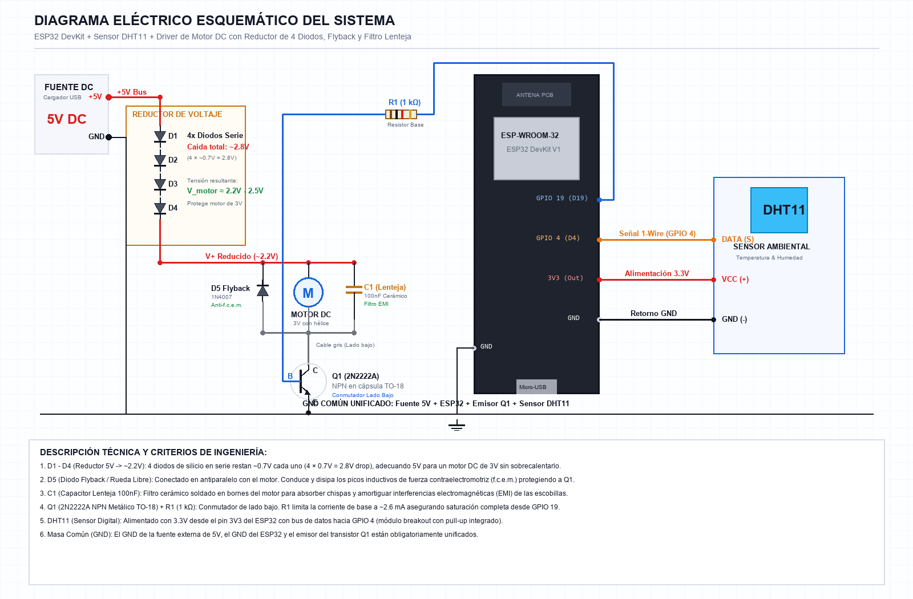

# 🌡️ Sistema de Control de Temperatura Inteligente con ESP32

[](LICENSE)
[](https://www.espressif.com/)
[-brightgreen.svg)](#hardware-y-componentes)
[](#hardware-y-componentes)

Sistema embebido de control y regulación térmica basado en el microcontrolador **ESP32**, sensor ambiental digital **DHT11** y actuador de ventilación forzada mediante motor de corriente continua. 

El circuito incorpora **etapa de potencia de lado bajo (*Low-Side Switch*) con transistor BJT 2N2222A**, **cadena de diodos reductores de tensión**, **protección inductiva flyback** y **filtrado de ruido electromagnético de escobillas**.

---

## 📑 Tabla de Contenidos

1. [Características Principales](#-características-principales)
2. [Estructura del Repositorio](#-estructura-del-repositorio)
3. [Diagrama Eléctrico Esquemático](#-diagrama-eléctrico-esquemático)
4. [Esquema de Circuito (ASCII)](#-esquema-de-circuito-ascii)
5. [Hardware y Componentes (BOM)](#-hardware-y-componentes-bom)
6. [Mapa de Conexiones (PINOUT)](#-mapa-de-conexiones-pinout)
7. [Fundamentos y Protección del Circuito](#-fundamentos-y-protección-del-circuito)
8. [Instalación y Puesta en Marcha](#-instalación-y-puesta-en-marcha)
9. [Licencia](#-licencia)

---

## 🚀 Características Principales

* **Monitoreo Digital de Temperatura y Humedad:** Adquisición precisa mediante sensor DHT11 utilizando protocolo unifilar (*1-Wire*) en GPIO 4.
* **Control Térmico por Histéresis:** Encendido a $\ge 28.0\,^\circ\text{C}$ y apagado a $\le 26.0\,^\circ\text{C}$ para evitar oscilaciones rápidas (*chattering*) y proteger la vida útil del motor.
* **Soporte para Modulación PWM:** Firmware preparado para control proporcional de velocidad del ventilador en función del gradiente térmico.
* **Regulación Segura de Tensión:** Cadena de 4 diodos rectificadores de silicio para reducir 5V DC a $\approx 2.2\,\text{V} - 2.5\,\text{V}$, protegiendo el motor de 3V contra sobrecalentamiento.
* **Protección Electrónica Integral:** Diodo flyback (rueda libre) para absorber la fuerza contraelectromotriz (f.c.e.m.) y capacitor cerámico tipo lenteja para supresión de chispas y ruido EMI.
* **Masa Unificada (GND Común):** Referencia eléctrica sólida entre la fuente externa de 5V, el microcontrolador y el transistor conmutador.

---

## 📂 Estructura del Repositorio

```text
Sistema-de-Control-de-Temperatura/
├── README.md                                  # Documentación principal del proyecto
├── LICENSE                                    # Licencia MIT
├── .gitignore                                 # Exclusiones estándar para Arduino y PlatformIO
├── docs/
│   └── teoria_circuito.md                     # Fundamentos teóricos y cálculos del circuito
├── firmware/
│   └── control_temperatura_esp32/
│       └── control_temperatura_esp32.ino      # Código fuente C++ para ESP32
└── hardware/
    └── schematics/
        ├── diagrama_electrico_esquematico.png # Diagrama eléctrico en alta resolución
        ├── diagrama_interactivo.html          # Visor interactivo SVG y panel técnico
        ├── BOM.md                             # Lista completa de materiales y referencias
        └── PINOUT.md                          # Guía detallada de patillaje y conexiones
```

---

## ⚡ Diagrama Eléctrico Esquemático

A continuación se muestra el esquema eléctrico del sistema con todos los componentes, nodos y asignación de pines:



> 💡 **Visor interactivo:** Puedes abrir en cualquier navegador el archivo [`hardware/schematics/diagrama_interactivo.html`](hardware/schematics/diagrama_interactivo.html) para inspeccionar interactivamente cada componente, sus fórmulas y funciones haciendo clic sobre ellos.

---

## 🔌 Esquema de Circuito (ASCII)

```text
                  +5V DC (Fuente Externa / Cargador USB)
                           |
                        [ANODO]
                          |\|    D1 (1N4007) ~0.7V drop
                          | \
                        -------
                        [CATODO]
                           |
                        [ANODO]
                          |\|    D2 (1N4007) ~0.7V drop
                          | \
                        -------
                        [CATODO]
                           |
                        [ANODO]
                          |\|    D3 (1N4007) ~0.7V drop
                          | \
                        -------
                        [CATODO]
                           |
                        [ANODO]
                          |\|    D4 (1N4007) ~0.7V drop
                          | \
                        -------
                        [CATODO]
                           |
                           +--- V+ Reducido (~2.2V - 2.5V)
                           |
          +----------------+----------------+
          |                |                |
       [CATODO]            |                |
        -------            |                |
         / |               |              -----  C1 (Capacitor Lenteja)
        /  |  D5           | (M) Motor    -----  100 nF (0.1 uF)
       [ANODO] (Flyback)   |  DC 3V         |    Filtro EMI Escobillas
          |                |                |
          +----------------+----------------+
                           |
                     (Cable Gris)
                           |
                           | Colector (C)
                         +---+
   ESP32 (GPIO 19)       |   |
         |       R1 1kΩ  |/  |  Q1: Transistor NPN (2N2222A)
         +-----[=====]---|   |      Encapsulado metálico TO-18
                (Azul)   |\  |      Conmutador Low-Side
                         +---+
                           | Emisor (E)
                           |
   GND COMÚN --------------+--------------------------------------+
   (Fuente 5V, ESP32 GND, Emisor Q1 y GND Sensor)                 |
                                                                  |
   +-----------------------------------------------------------+  |
   |                     ESP32 DEVKIT                          |  |
   |                                                           |  |
   |   [3V3] -------------------------------- (Rojo) --------+ |  |
   |                                                          | | |
   |   [GPIO 4 (D4)] ------------------------- (Naranja) ---+ | | |
   |                                                        | | | |
   |   [GND] -----------------------------------------------+ | | |
   +----------------------------------------------------------+ | |
                                                                | | |
                                                +---------------+ | |
                                                |  DHT11 SENSOR   | |
                                                |                 | |
                                                | [1] VCC (+) <---+ |
                                                | [2] DATA (S) <--+ |
                                                | [3] GND (-) <-----+
                                                +-----------------+
```

---

## 🛠️ Hardware y Componentes (BOM)

| Ref. | Componente | Modelo / Valor | Función |
| :---: | :--- | :--- | :--- |
| **U1** | Microcontrolador | **ESP32 DevKit V1** (ESP-WROOM-32) | Procesamiento y control lógico |
| **SEN1** | Sensor Ambiental | **DHT11** (Módulo 3 Pines) | Medición de temperatura y humedad |
| **M1** | Actuador | **Motor DC 130 (3V) con hélice** | Ventilación forzada de refrigeración |
| **Q1** | Transistor BJT NPN | **2N2222A** (TO-18 metálico) | Interruptor electrónico *Low-Side* ($I_C \le 800\,\text{mA}$) |
| **R1** | Resistor de Base | **1 kΩ (1/4 W, 5%)** | Limita corriente de base a $I_B \approx 2.6\,\text{mA}$ |
| **D1-D4**| Diodos Reductores| **4x 1N4007** (o 1N4001 - 1N4004) | Reducción de 5V a $\approx 2.2\,\text{V}$ ($4 \times 0.7\,\text{V}$ drop) |
| **D5** | Diodo Flyback | **1N4007** (en antiparalelo) | Supresión de picos inductivos de f.c.e.m. |
| **C1** | Capacitor Cerámico | **100 nF (0.1 µF)** tipo lenteja | Supresión de chispas y ruido EMI de escobillas |
| **PS1**| Fuente de Poder | **5V DC (USB 1A+)** | Alimentación de potencia para el motor |

> Para especificaciones detalladas, consulta el documento [`hardware/schematics/BOM.md`](hardware/schematics/BOM.md).

---

## 📌 Mapa de Conexiones (PINOUT)

| Desde (Componente) | Pin de Origen | Color Cable | Hacia (Componente) | Pin de Destino | Descripción |
| :--- | :--- | :--- | :--- | :--- | :--- |
| **Fuente 5V** | Positivo `+5V` | Rojo | **Diodo D1** | Ánodo | Entrada de alimentación |
| **D1 &rarr; D4** | Cátodo D4 | Rojo | **Motor DC** | Borne (+) | Tensión reducida ($\approx 2.2\,\text{V}$) |
| **Motor DC** | Borne (-) | Gris | **Transistor Q1** | Colector (C) | Retorno controlado a tierra |
| **Transistor Q1** | Emisor (E) | Negro | **GND Común** | GND (Fuente / ESP32) | Cierre a masa |
| **Transistor Q1** | Base (B) | Azul | **Resistor R1** | Extremo 2 | Polarización de base |
| **Resistor R1** | Extremo 1 | Azul | **ESP32** | `GPIO 19` (D19) | Señal de activación / PWM |
| **ESP32** | `3V3` | Rojo | **Sensor DHT11** | Pin `VCC` (+) | Alimentación de 3.3V |
| **ESP32** | `GPIO 4` (D4) | Naranja | **Sensor DHT11** | Pin `DATA` (S) | Bus digital 1-Wire |
| **ESP32** | `GND` | Negro | **Sensor DHT11** | Pin `GND` (-) | Retorno de tierra del sensor |
| **Fuente 5V** | Negativo `GND` | Negro | **ESP32** | `GND` | **Unificación obligatoria de masa** |

> Para ver la guía física con vistas de encapsulado del transistor TO-18 y del módulo DHT11, consulta [`hardware/schematics/PINOUT.md`](hardware/schematics/PINOUT.md).

---

## 🔬 Fundamentos y Protección del Circuito

1. **¿Por qué 4 diodos en serie?**  
   Los motores de corriente continua miniatura operan óptimamente a 3V o menos. Cada diodo de silicio en polarización directa resta $\approx 0.7\,\text{V}$. Al conectar 4 en serie se obtiene una reducción acumulada de $4 \times 0.7\,\text{V} = 2.8\,\text{V}$, dejando los $5.0\,\text{V}$ de la fuente en $\approx 2.2\,\text{V} - 2.5\,\text{V}$, previniendo el recalentamiento y desgaste mecánico prematuro.
2. **¿Por qué es indispensable el diodo flyback D5?**  
   Al desconectar el motor, la inductancia del devanado genera un pico inverso de voltaje ($\Delta V = -L \frac{di}{dt}$) que puede sobrepasar los $50\,\text{V}$. D5 en antiparalelo conduce dicho pulso y disipa la energía de forma segura, impidiendo la destrucción del transistor 2N2222A.
3. **¿Cuál es el rol del capacitor lenteja C1?**  
   Las escobillas del motor generan micro-chispas al rozar las delgas del rotor, emitiendo ruido electromagnético de alta frecuencia (EMI). El capacitor cerámico de $100\,\text{nF}$ filtra estas interferencias en el propio motor, evitando que desestabilicen las lecturas del DHT11 o causen reinicios (*brownouts*) en el ESP32.

> Para un análisis matemático y físico completo, consulta [`docs/teoria_circuito.md`](docs/teoria_circuito.md).

---

## 💻 Instalación y Puesta en Marcha

### Requisitos de Software
1. **Arduino IDE 2.x** (o PlatformIO en VS Code).
2. Paquete de placas **ESP32 by Espressif Systems** instalado en el Administrador de Tarjetas:
   * URL de tarjetas adicionales: `https://raw.githubusercontent.com/espressif/arduino-esp32/gh-pages/package_esp32_index.json`
3. Librerías requeridas (instalar desde el Gestor de Librerías de Arduino):
   * **DHT sensor library** by Adafruit.
   * **Adafruit Unified Sensor** by Adafruit.

### Procedimiento
1. Abre el archivo de firmware en Arduino IDE:
   ```text
   firmware/control_temperatura_esp32/control_temperatura_esp32.ino
   ```
2. Selecciona la placa: **ESP32 Dev Module** (o ESP32 Wrover / DOIT ESP32 DEVKIT V1).
3. Conecta el ESP32 por USB y selecciona el puerto COM asignado.
4. Presiona **Subir (Upload)**.
5. Abre el **Monitor Serie** a una velocidad de **115200 baudios** para visualizar la telemetría en tiempo real:
   ```text
   [TELEMETRIA] Temp: 28.4 °C | Humedad: 52.0 % | Ventilador: ENCENDIDO (HIGH)
   ```

---

## 📄 Licencia

Este proyecto se distribuye bajo la licencia **MIT**. Para más detalles, consulta el archivo [LICENSE](LICENSE).
